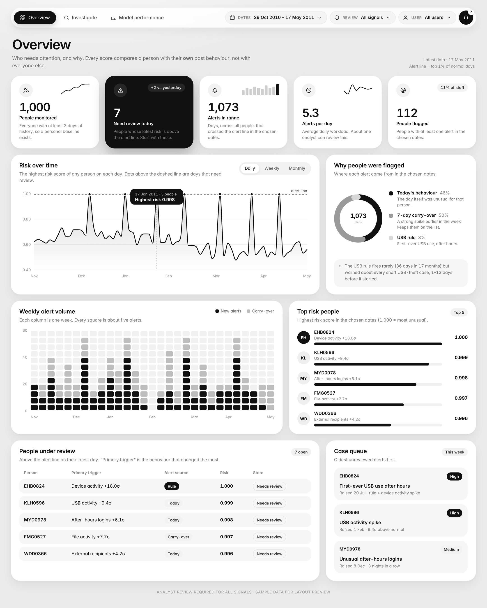
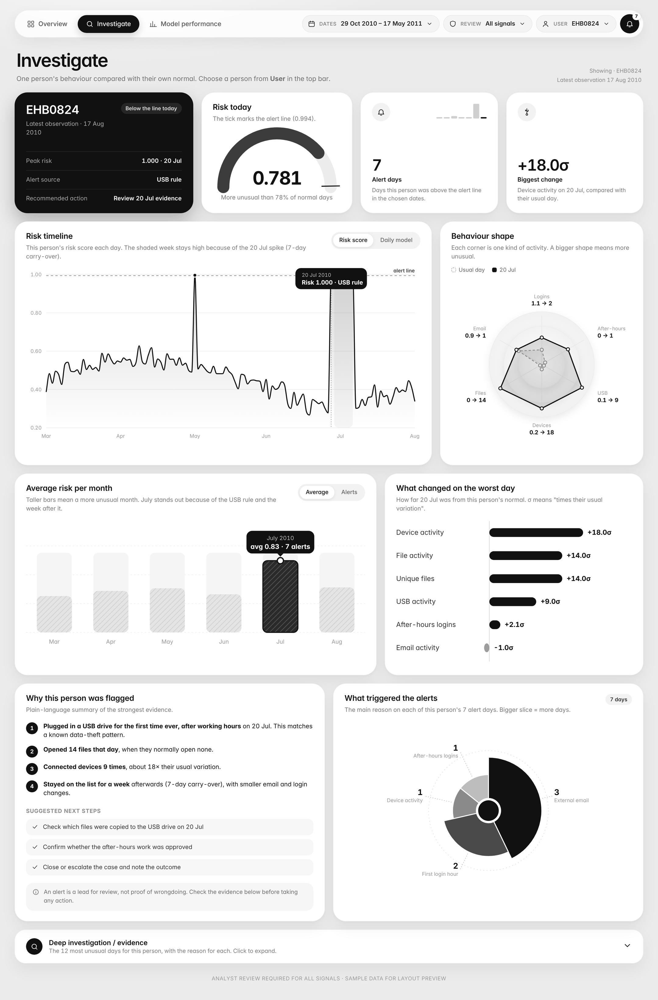
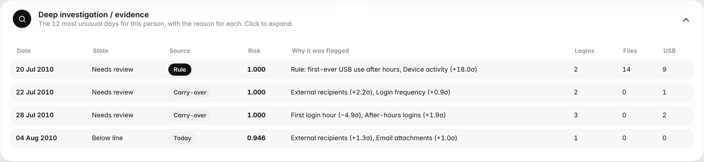
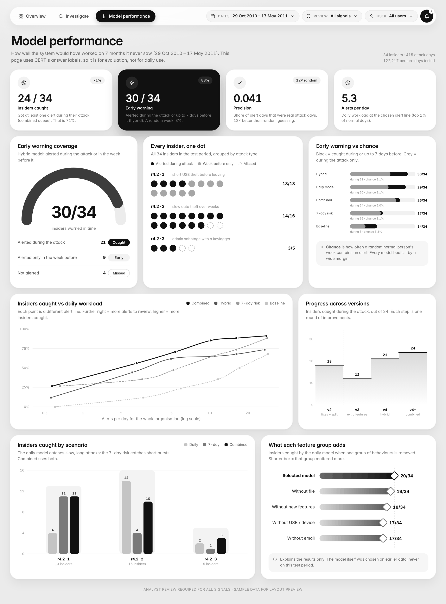
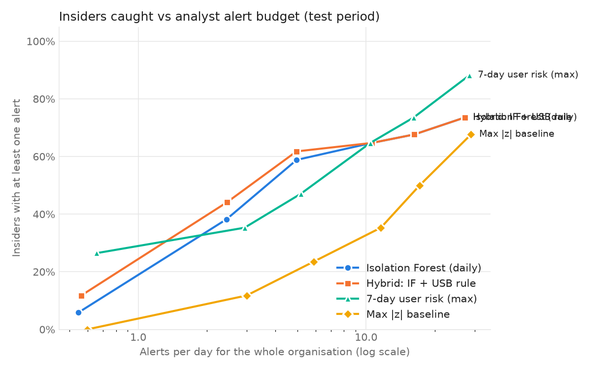
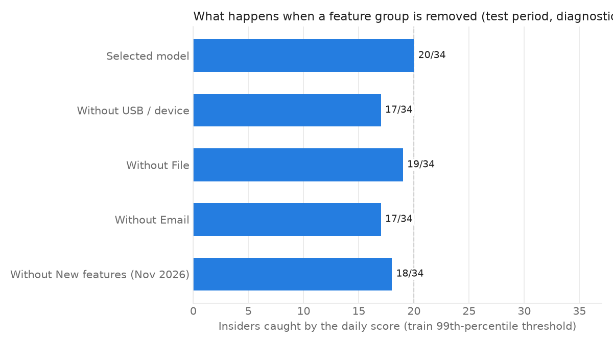

# Insider Threat Detection via UEBA

[](https://github.com/yoshitagandhi/insider-threat-ueba/actions/workflows/tests.yml)

An interpretable User and Entity Behavior Analytics (UEBA) project for the CERT
Insider Threat Test Dataset r4.2. Instead of comparing people with a population
average, it asks whether a person's behaviour is unusual **for that person**,
explains every alert in plain language, and shows the results in a
black-and-white analyst dashboard.

The project is deliberately analyst-assistive: an alert is an investigation
lead, not evidence of intent and never an automated personnel decision.

**Contents:** [At a glance](#at-a-glance) ·
[Dashboard](#dashboard) · [How it works](#how-it-works) ·
[Results](#results) · [What v3 taught us](#what-v3-taught-us) ·
[Quick start](#quick-start) · [Project structure](#project-structure) ·
[Testing](#testing) · [Design decisions and limitations](#design-decisions-and-limitations) ·
[Next steps](#possible-next-steps) · [Talking points](#interview-talking-points)

## At a glance

Evaluated on 7 months the model never saw (122,217 person-days, 34 insiders),
with every alert threshold taken from the training period only:

- **24 of 34 insiders (71%)** get at least one alert during their attack
  (combined queue), at about **5 alerts a day** for a ~1,000-person company.
- **30 of 34 insiders (88%)** get an alert during the attack **or in the week
  before it** (hybrid model). A random normal person's week has a 3% chance.
- Precision is **12× better than random guessing** and 5× better than a
  statistical baseline.
- Every scored day comes with a plain-English reason, for example
  `Rule: first-ever USB use after hours, Device activity (+18.0σ)`.

## Dashboard

`streamlit run dashboard/app.py` opens a minimalist black-and-white dashboard.
A floating top bar holds three pages and the **Dates**, **Review** and **User**
filters. Every card has a one-line explanation so a non-specialist can read it.

> The images below are the approved **design preview with sample data**. The
> running app shows the same layout filled with your own scored data.

**Overview**: who needs attention and why. People monitored, people needing
review now, alerts per day, alerts over time, why people were flagged
(today's behaviour, 7-day carry-over or USB rule), weekly alert volume, top
people, recent alerts and a case queue.



**Investigate**: one person compared with their own normal. A risk gauge, a
risk timeline with carry-over days shaded, a radar of their usual day vs their
worst day, risk per month, the biggest changes, plain-language reasons and
next steps, what triggered their alerts, and the evidence table in a dropdown.





**Model performance**: the offline evaluation. Insiders caught, early warning
vs chance (a gauge and one dot per insider), insiders caught vs daily
workload, progress across versions, results by attack scenario and the
feature-group ablation. It uses CERT's answer labels, so it is for evaluation,
not daily use.



All charts (gauge, radar, rose, dot matrix, hatched bars, step chart and more)
are drawn as SVG by `dashboard/svg_charts.py` and embedded as images, so the
dashboard needs no charting library. Streamlit's `st.html` removes inline SVG,
which is why each chart is converted to a `data:image/svg+xml` image.

## How it works

```text
CERT event CSVs (logon, device, file, email)
  → one row per person per day (13 behaviour features)
  → 14-day personal baseline built only from earlier days
  → z-scores: how unusual today is for this person
  → time-based split: train on the first 60% of dates, test on the rest
  → feature-set choice on a validation window inside the training period
  → Isolation Forest daily score + plain-English top_reasons
  → hybrid score: model + "first-ever USB use after hours" rule
  → 7-day user risk (highest daily score in the last week)
  → combined queue: daily score OR 7-day risk, at the same alert budget
  → offline evaluation with CERT answer labels
  → Streamlit dashboard (Overview, Investigate, Model performance)
```

Key ideas:

- **Leakage guard.** The baseline for day *t* only contains behaviour from
  before day *t* (`shift(1)` before the rolling window). Every later feature
  follows the same rule of looking only backwards.
- **Honest evaluation.** The alert line is the 99th percentile of *training*
  scores, and the test period is used exactly once.
- **People, not days.** Detection is counted per insider, because an analyst
  only needs one good alert to open a case.
- **Rules plus machine learning.** One hand-written rule catches a known
  data-theft pattern without taking alert slots from the model.
- **Labels never fit a model.** `is_malicious` is used for test-period
  evaluation and, inside the training period only, to compare candidate
  feature sets on the validation window.

## Results

Results from the v4 pipeline. The model is fitted on days before
**29 Oct 2010** and evaluated on the later, unseen days: 122,217 person-days,
415 of them malicious, belonging to 34 insiders.

| Test period | Insiders caught | Precision | Recall (days) | F1 | PR-AUC | Alerts per day |
|---|---|---|---|---|---|---|
| **Combined queue: daily OR 7-day risk + rule** | **24/34 (71%)** | **0.041** | **0.106** | **0.059** | 0.034 | 5.3 |
| Hybrid: Isolation Forest + USB rule | 21/34 | 0.030 | 0.072 | 0.043 | 0.024 | 5.0 |
| Isolation Forest (daily) | 20/34 | 0.029 | 0.070 | 0.041 | 0.023 | 5.0 |
| 7-day user risk (max) | 16/34 | 0.038 | 0.094 | 0.054 | **0.035** | 5.2 |
| Max-\|z\| baseline | 8/34 | 0.008 | 0.022 | 0.011 | 0.007 | 5.9 |
| Random guessing | - | 0.0034 | - | - | 0.0034 | - |

- Only 0.34% of test days are malicious, so precision of 0.041 is about
  **12× better than random**.
- The combined queue wins at every alert budget: at about 10 alerts a day it
  catches **29 of 34** insiders, and at about 2.7 a day it still catches 19.

### By attack scenario

Insiders with at least one alert on a malicious test day:

| Scenario | What happens | Insiders | Daily model | Hybrid | 7-day risk | **Combined** | Baseline |
|---|---|---|---|---|---|---|---|
| r4.2-1 | short USB data theft before leaving | 13 | 4 | 4 | **11** | **11** | 2 |
| r4.2-2 | slow data theft over weeks | 16 | **14** | **14** | 4 | 10 | 6 |
| r4.2-3 | admin sabotage with a keylogger | 5 | 2 | **3** | 1 | **3** | 0 |
| **All** | | **34** | 20 | 21 | 16 | **24** | 8 |

The daily score and the 7-day risk catch almost opposite scenarios. The
combined queue turns each into a training percentile, takes the higher one,
and gives each about half of the same alert budget, with no hand-picked
weights.

### Early warning: alerts in the week before the attack

CERT labels only the attack days themselves, so an alert a few days earlier
counts as a false positive even though it is just as useful to an analyst.
The report also counts an insider as caught if an alert came during the attack
**or in the 7 days before it**, with a chance check: how often a random 8-day
window of a normal person contains an alert.

| Test period | During attack | **During or ≤ 7 days before** | Chance level |
|---|---|---|---|
| **Hybrid: Isolation Forest + USB rule** | 21/34 | **30/34 (88%)** | 3.1% |
| Isolation Forest (daily) | 20/34 | 29/34 | 3.1% |
| Combined queue | **24/34** | 26/34 | 2.0% |
| 7-day user risk (max) | 16/34 | 17/34 | 1.1% |
| Max-\|z\| baseline | 8/34 | 14/34 | 5.3% |

- By chance alone you would expect about one of the 34 insiders to be credited.
- **r4.2-1 rises to 13/13.** The rule diagnosis shows the first-ever-USB rule
  fired for every r4.2-1 insider on their first USB day, **1 to 13 days
  before** CERT's first labelled attack day. The rule fired on only 36
  person-days in 17 months.
- **The best model depends on the question:** the combined queue is best for
  catching people *during* the attack (24/34), the hybrid for *before or
  during* it (30/34).

### Progress across versions

| Version | What changed | Insiders caught | Precision | PR-AUC |
|---|---|---|---|---|
| v1 | Scored on the training period itself | (not measured) | 0.018 | 0.014 |
| v2 | Cold-start and zero-variance fixes, time split | 18/34 | 0.028 | 0.015 |
| v3 | Three r4.2-1 features fed into the model | 12/34 | 0.015 | 0.014 |
| v4 hybrid | Validation-selected features + USB rule | 21/34 | 0.030 | 0.024 |
| **v4 combined** | + daily OR 7-day risk queue | **24/34** | **0.041** | **0.034** |

v1 was scored on the days it was trained on and used a more generous PR-AUC
formula, so it is not directly comparable. Most alerts are still false
positives, so this is an analyst-assistive detector, not an automated one.

### Charts

Generated by `python -m src.evaluation.analysis`:





The ablation uses the test period, so it explains results but is never used to
choose the model.

## What v3 taught us

v3 added three features aimed at r4.2-1 (after-hours USB, after-hours file
activity and a 0/1 "first-ever USB use" flag fed straight into the model) plus
a 7-day *average* risk score.

| Insiders caught (test) | v2 | v3 |
|---|---|---|
| r4.2-1 (the target) | 2/13 | **5/13** |
| r4.2-2 | 14/16 | **4/16** |
| r4.2-3 | 2/5 | 3/5 |
| **All** | **18/34** | **12/34** |

- The features worked on their target, but the alert budget is fixed (top 1%
  of days). Ordinary people's first-USB and after-hours days started taking
  alert slots that used to go to r4.2-2 insiders.
- A test-period ablation showed that *fewer* inputs did better, and the 7-day
  average smoothed away the spikes that catch insiders (3/34).

Picking the best ablation row would have meant choosing the model by looking
at the test set. v4 fixes it properly:

1. **Validation-based feature selection** (`src/models/feature_selection.py`):
   five candidate feature sets are compared on a validation window inside the
   training period (first 75% fit, last 25% validate), ranked by insiders
   caught with PR-AUC as tie-break. The winner is refitted and tested once,
   and saved in `models/selected_features.json`.
2. **Hybrid rule** (`src/models/rules.py`): the first-ever-USB flag becomes a
   rule (first-ever USB day plus after-hours activity) instead of a model
   input, so it targets r4.2-1 without crowding out other alerts.
3. **7-day risk uses the maximum**, so a strong spike keeps a person near the
   top of the queue for a week.

## Quick start

Requires Python 3.10+ (tested locally with Python 3.14).

### 1. Get the data

Download the [CERT Insider Threat Test Dataset, release r4.2](https://kilthub.cmu.edu/articles/dataset/Insider_Threat_Test_Dataset/12841247)
and its answer files, then place them here (they are ignored by Git):

```text
data/raw/r4.2/
  logon.csv
  device.csv
  file.csv
  email.csv
data/answers/r4.2/
  r4.2-1/ ...
  r4.2-2/ ...
  r4.2-3/ ...
```

### 2. Install and run

```bash
python -m venv .venv
.venv\Scripts\activate             # Windows (source .venv/bin/activate on macOS/Linux)
pip install -r requirements-dev.txt
python -m src.pipeline             # features, baselines, feature selection, scoring
python -m src.evaluation.report    # test-period results, early warning, rule diagnosis
python -m src.evaluation.analysis  # alert-budget and ablation charts in reports/
streamlit run dashboard/app.py     # the dashboard
```

| Command | What it produces |
|---|---|
| `src.pipeline` | `data/processed/scored_daily.parquet`, `models/isolation_forest.joblib`, `models/selected_features.json` |
| `src.evaluation.report` | precision, recall, F1, PR-AUC and insiders caught for every score, per scenario, early warning vs chance, and the r4.2-1 rule diagnosis |
| `src.evaluation.analysis` | `reports/alert_budget.{csv,png}` and `reports/ablation.{csv,png}` (refits the model several times, so allow a minute) |
| `dashboard/app.py` | the three-page dashboard, read from the scored file without refitting |

The pipeline reads multi-gigabyte event data, so allow time. The optional
PyTorch autoencoder experiment needs `pip install -r requirements-experiments.txt`.

### Evaluation notebook

`notebooks/01_eda.ipynb` walks through the raw data, features, personal
baselines, the feature selection and a test-period evaluation (report table,
insiders per scenario, rule diagnosis, PR curves, alert budget, confusion
matrix, a user timeline and error analysis). Run `python -m src.pipeline`
first.

## Project structure

```text
src/
  data/loaders.py              # raw event loading
  features/user_day.py         # daily behaviour features
  baselines/                   # personal baselines, z-scores, top_reasons
  models/isolation_forest_model.py  # time split, fit and score
  models/feature_selection.py  # validation-based choice of model inputs
  models/rules.py              # first-ever-USB-after-hours rule + hybrid score
  models/user_risk.py          # 7-day user risk score
  models/combined.py           # combined queue, alert source, risk score
  evaluation/report.py         # test-period report, insiders caught, early warning
  evaluation/analysis.py       # alert-budget and ablation charts
  evaluation/diagnosis.py      # why the rule did or did not catch each insider
dashboard/
  app.py                       # Streamlit app: top bar and three pages
  metrics.py                   # turns the scored file into card numbers
  svg_charts.py                # black-and-white SVG charts
  ui.py                        # stylesheet and small HTML helpers
docs/images/                   # dashboard design preview images
reports/                       # charts and tables written by analysis.py
notebooks/01_eda.ipynb         # EDA and evaluation walkthrough
tests/                         # unit and evaluation tests
.streamlit/config.toml         # black-and-white Streamlit theme
.github/workflows/tests.yml    # CI on Python 3.10–3.12
```

## Testing

```bash
pytest
```

40 tests cover feature correctness (logoff exclusion, distinct PCs,
after-hours USB and file counts, the first-ever USB flag), leakage and
cold-start behaviour, the standard-deviation floor, `top_reasons` wording, the
time-based split, train-only thresholds, feature-selection ranking and
fallback, the hybrid rule, the 7-day risk, the combined queue and alert
source, insiders caught and early warning, the rule diagnosis, feature-group
coverage, and the dashboard's card calculations and SVG-to-image conversion.
GitHub Actions runs them on Python 3.10, 3.11 and 3.12 for every push and pull
request.

## Design decisions and limitations

- **Cold start.** People with fewer than three earlier days stay unscored; no
  population baseline is invented for them. An earlier version filled their
  z-scores with 0, which silently scored them as perfectly normal.
- **Standard-deviation floor.** Each feature's spread is raised to a small
  floor (1 event, or 0.1 for the external-recipient ratio). Without it, someone
  who had never used a USB drive (spread 0) got a z-score of 0 on the day they
  first plugged one in.
- **Features.** `distinct_pcs` and `first_logon_hour` were added in v2 (the
  hour is carried forward on days with no logon, not set to midnight).
  `after_hours_usb_count`, `after_hours_file_count` and `first_usb_ever` target
  r4.2-1; the flag is built from earlier days only and is used by the rule,
  not the model.
- **7-day risk** is the highest daily score in the last 7 scored days, today
  included and nothing later.
- **The training period contains some malicious days.** That is acceptable for
  an unsupervised model because labels are never used for fitting.
- **Early-warning window** is a fixed 7 days, chosen before looking at the
  results. Its chance check uses normal people only.
- **Ablation** is computed on the test period, so it explains results but is
  never used to choose the model.
- **HTTP data** (`http.csv`) is excluded after an experiment showed no benefit
  for r4.2-2; the chunked feature code remains for follow-up work.
- **Anchor baseline.** A fixed 21-observation baseline is available as an
  experiment.
- **Dashboard.** A high risk score on a quiet day usually comes from the 7-day
  risk carrying an earlier spike forward; the "Alert source" column says so.
  Charts are images, so they have callout bubbles but no hover tooltips.
- **Anomaly scores do not establish malicious intent.**

## Possible next steps

- A rolling (walk-forward) split that refits every month instead of one fixed
  cut-off date.
- A hyperparameter search over Isolation Forest's `n_estimators` and
  `max_samples` on the same validation window used for feature selection.
- HTTP features for a short list of domains (file-sharing and job sites),
  since r4.2-1 insiders upload data to a leak site that only `http.csv` shows.

## Interview talking points

1. **The leakage guard.** The baseline for day *t* only sees behaviour before
   day *t*, and every later feature follows the same rule.
2. **Choosing the right metric.** Per day, r4.2-2 looked like the hardest
   scenario (6.7% recall). Per insider, 14 of 16 were caught, and the real gap
   was r4.2-1. The same idea led to the early-warning count, which showed the
   USB rule warned about every r4.2-1 insider days in advance.
3. **Evaluation honesty.** Moving to a forward-looking time split and fixing
   two silent z-score bugs made the evaluation stricter *and* improved every
   metric.
4. **Honest model selection.** The v3 features helped their target but hurt
   overall, and the tempting fix came from the test set. Choosing on a
   validation window and turning the flag into a rule keeps the final result
   trustworthy.

## Data policy and licence

Raw events, derived parquet files and answer files are not stored in Git.
The MIT licence applies to this project's code, not to the CERT data or
answer files; follow the dataset provider's terms for those materials.
